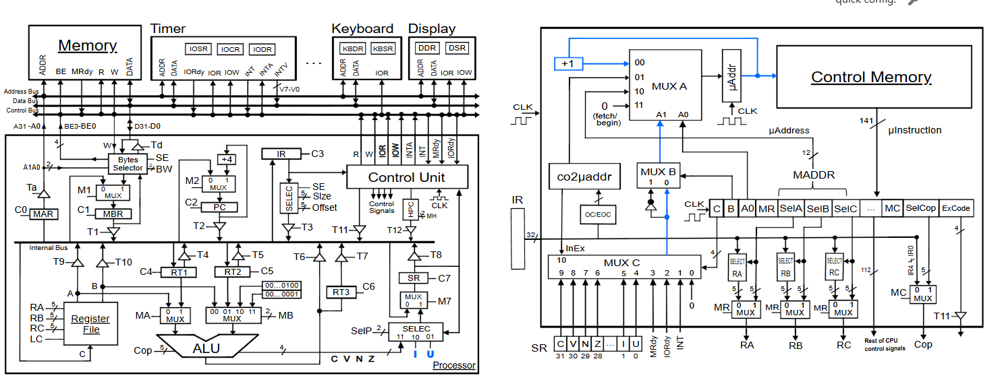

# Práctica 2 – WepSim: extensión de microcódigo

Práctica de **Estructura de Computadores** (Grado en Ingeniería Informática, 2.º curso, grupo 85) en la que se amplía el repertorio de instrucciones del procesador simulado en **WepSim** escribiendo nuestro propio microcódigo, y se mide el impacto que tiene sobre un programa real (un semáforo de 8 × 24 LEDs).

## Autores

- Jaime Sánchez Sánchez
- Ana Díaz Jiménez

## Contenido

1. [Descripción](#descripción)
2. [Ejercicio 1: nuevas instrucciones](#ejercicio-1-nuevas-instrucciones)
3. [Ejercicio 2: comparativa de rendimiento](#ejercicio-2-comparativa-de-rendimiento)
4. [Problemas encontrados](#problemas-encontrados)
5. [Conclusiones](#conclusiones)
6. [Cómo usarlo](#cómo-usarlo)

## Descripción

La práctica consta de dos partes:

- **Ejercicio 1:** diseño en microcódigo de seis instrucciones nuevas (`lx`, `call`, `return`, `stop`, `vfill` y `vadd`), describiendo para cada una su comportamiento en lenguaje RT, las señales de control activadas en cada ciclo y las decisiones de diseño tomadas.
- **Ejercicio 2:** ejecución del mismo programa (un semáforo sobre una matriz de 8 × 24) con y sin las instrucciones del ejercicio 1, para comparar el número de ciclos de reloj y valorar si compensa la extensión.



## Ejercicio 1: nuevas instrucciones

| Instrucción | Descripción | Tamaño |
|---|---|---|
| `lx RR1, U32` | Carga en `RR1` un valor inmediato de 32 bits | 64 bits |
| `call U32` | Llama a una subrutina: apila el `PC` y salta a la dirección `U32` | 64 bits |
| `return` | Desapila la dirección de retorno y la carga en `PC` | 32 bits |
| `stop` | Pone `PC` y `SP` a cero, deteniendo el programa | 32 bits |
| `vfill RR1, (RR2), U8` | Escribe el byte `U8` en `RR1` posiciones consecutivas a partir de la dirección `RR2`. Al terminar, `RR2 ← RR2 + RR1` y `RR1 ← 0` | 32 bits |
| `vadd RR1, (RR2), RR3` | Recorre `RR1` posiciones a partir de la dirección `RR2` sumando `RR3` a cada una. Al terminar, `RR2 ← RR2 + RR1` y `RR1 ← 0` | 32 bits |

### Diseño en lenguaje RT

#### `lx RR1, U32`

```
1. MAR <- PC
2. MBR <- MP[MAR], PC <- PC + 4
3. RR1 <- MBR
```

Al ser una instrucción de 64 bits, hay que leer la segunda palabra sin alterar `IR`. Para ello se hace un *fetch* adicional que **no** pasa el valor de `MBR` a `IR`, sino que lo carga directamente en el registro destino.

#### `call U32`

```
1. MAR <- PC
2. MBR <- MP[MAR], PC <- PC + 4
3. RT1 <- MBR
4. SP <- SP - 4, MAR <- SP
5. MP[SP] <- PC
6. PC <- RT1
```

También ocupa 64 bits, así que se repite el *fetch* sin pasar por `IR` y se guarda la dirección de destino en `RT1`. Después se decrementa `SP` en 4, se apila el `PC` (dirección de retorno) y, por último, se carga en `PC` la dirección guardada en `RT1`, pasando a ejecutar la subrutina.

#### `return`

```
1. MAR <- SP
2. MBR <- MP[SP], SP <- SP + 4
3. PC <- MBR
```

Recupera de la pila la dirección de retorno: se usa `SP` como dirección, se lee el valor, se desapila (`SP + 4`) y se carga en `PC` para continuar con la instrucción siguiente a la llamada.

#### `stop`

```
1. PC <- zero, SP <- zero
```

Se toma el valor 0 del registro `zero` y se vuelca en `PC` y `SP`, deteniendo la ejecución.

#### `vfill RR1, (RR2), U8`

```
1. RT2 <- SR
2. RT1 <- zero
3. MBR <- U8, RT3 <- RT2
4. RT2 <- RR2, MAR <- RR2
5. inicio: MP[MAR] <- MBR
6. MAR <- RR2 + RT1, if RR1 - RT1 == 0 -> fin
7. RT1 <- RT1 + 1, return inicio
8. fin: RR2 <- RR2 + RR1
9. RR1 <- 0
10. SR <- RT3
```

`RT1` actúa de contador (`i`), que crece desde 0 hasta el valor de `RR1`. El byte `U8` se mantiene en `MBR` durante todo el bucle y en cada vuelta se escribe en la dirección `RR2 + i`. Si `RR1 - RT1 == 0` se sale del bucle; si no, se incrementa `RT1` y se vuelve a `inicio`. Al salir se actualizan `RR2` y `RR1` como se pide, y se restaura `SR` (que se había guardado en `RT2`/`RT3` porque la resta del bucle modifica los flags).

#### `vadd RR1, (RR2), RR3`

```
1. RT2 <- SR
2. RT1 = 0, SR = SR + 0
3. inicio: RR2 + RT1 -> MAR
4. MP[MAR] -> MBR, RR1 - i -> SR
5. SR == 0 -> fin, MBR -> RT2
6. RT2 + RR3 -> MBR
7. RT1 = RT1 + 1, MBR -> MP[MAR], salto a inicio
8. fin: RR2 <- RR2 + RR1
9. RR1 <- 0
10. SR <- RT3
```

Mismo esquema que `vfill`, pero en cada iteración se lee el byte de memoria, se le suma `RR3` y se vuelve a escribir. La comparación `RR1 - i` decide si se termina el bucle.

## Ejercicio 2: comparativa de rendimiento

### Diferencias entre ambos códigos

- **Código 1 (sin extensión):** usa únicamente instrucciones de ensamblador cuyo microcódigo ya viene dado.
- **Código 2 (con extensión):** utiliza las instrucciones del ejercicio 1, cuyo microcódigo hemos tenido que escribir nosotros.

Crear microcódigo es bastante más complejo que usar una instrucción de ensamblador, pero permite adaptar el procesador a las necesidades del programa. El resultado es un código ensamblador más limpio y mucho más eficiente al combinarlo con instrucciones de microcódigo específicas.

### Ventajas e inconvenientes

| | Ventajas | Inconvenientes |
|---|---|---|
| **Sin extensión** | No requiere instrucciones adicionales; basta con el repertorio básico | Repite muchas instrucciones en ensamblador y necesita muchos ciclos de reloj |
| **Con extensión** | Instrucciones específicas: menos ciclos de reloj y código más corto | Hay que codificar el microcódigo a mano, con más margen de error y de mal funcionamiento |

### Resultados

| Programa | Ciclos sin extensión | Ciclos con extensión | Mejora |
|---|---:|---:|---:|
| Semáforo 8 × 24 | 54959 | 6410 | 857,39 % (≈ ×8,57) |

La versión con extensión ahorra **48549 ciclos de reloj**.

### Proceso de optimización

Tras tener las instrucciones funcionando, optimizamos el microcódigo para reducir ciclos. Evolución de las versiones (ciclos con extensión):

| Versión | Ciclos (sin extensión) | Ciclos (con extensión) |
|---|---:|---:|
| segundo | 54959 | 8423 |
| tercero | 54959 | 7919 |
| cuarto | 54959 | 7415 |
| quinto | 54959 | 6914 |
| sexta | 54959 | 6404 |
| final | 54959 | 6410 |
| final_final (con `SR`) | 54959 | 6410 |

Creemos que aún se podría optimizar más, pero nos detuvimos aquí al considerar los resultados más que aceptables.

### ¿Merece la pena la extensión?

Sí. Con las instrucciones del ejercicio 1 el programa es notablemente más rápido, más eficiente y menos complejo de escribir en ensamblador.

## Problemas encontrados

1. **`return` no funcionaba:** no guardaba bien los datos en `SP`, por lo que no se podían anidar más de 2 `return`. Costó encontrar el error porque hubo que ir probando casos.
2. **`vfill`/`vadd` no rellenaban la matriz:** había un acceso a `MAR` de más, y el valor no llegaba a almacenarse correctamente.
3. **`vfill`/`vadd` seguían fallando** aun siendo lógicamente correctos: el error era usar `BW = 01` pensando que era el tamaño más pequeño, cuando el byte es `BW = 00`.
4. **`call`** no cargaba bien el `PC` desde `SP`.

## Conclusiones

- En microcódigo hay que ser muy preciso: un acceso equivocado o una mala ordenación de las microoperaciones puede alterar por completo el resultado.
- La práctica nos ha ayudado a entender cómo funciona el microcódigo, cómo se ejecutan los saltos y qué elementos intervienen en un proceso tan común como cambiar el color de una matriz.
- Se comprueba que las instrucciones diseñadas a medida son mucho más eficientes que las generales, ya que permiten hacer más operaciones en paralelo a nivel de microcódigo que en ensamblador.

## Cómo usarlo

> Ajustad los nombres de fichero a los de vuestro repositorio.

1. Abrir [WepSim](https://wepsim.github.io/wepsim/).
2. Cargar el fichero de microcódigo con las nuevas instrucciones (`lx`, `call`, `return`, `stop`, `vfill`, `vadd`).
3. Cargar el programa en ensamblador del semáforo (versión sin extensión o con extensión).
4. Ensamblar y ejecutar, y comparar el número de ciclos de reloj entre ambas versiones.

## Estructura del repositorio

```
.
├── README.md
├── microcodigo/      # Microcódigo de las instrucciones del ejercicio 1
├── ensamblador/      # Programas del semáforo (con y sin extensión)
└── memoria.pdf       # Memoria completa de la práctica
```
